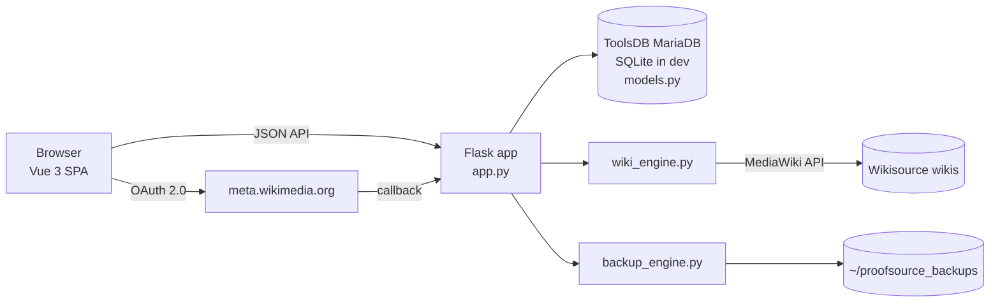
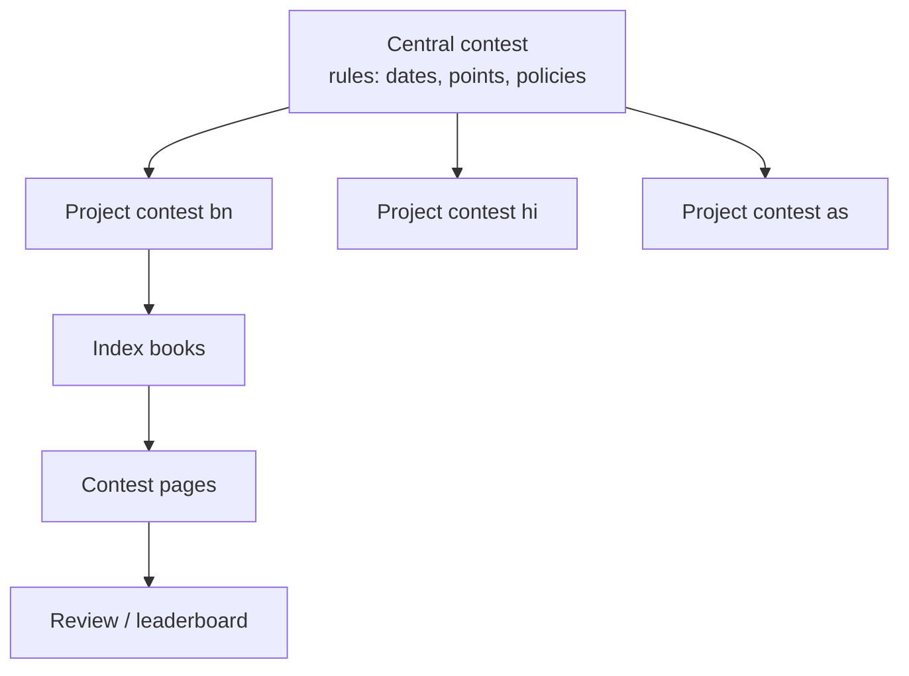

<div align="center">


# ProofSource — Architecture

**System design, data model and internals**


</div>

ProofSource is a web tool for running **proofreading contests on Wikisource** (any language). It tracks which pages were proofread during a contest, lets reviewers (juries) accept or reject them, keeps a leaderboard, and supports multi-wiki **central contests** with one combined leaderboard.

- **Live:** `https://proofsource.toolforge.org` · **Staging:** `https://proofsource-test.toolforge.org`
- **Hosting:** Wikimedia Toolforge (Kubernetes webservice, `python3.11`, uWSGI)
- **Stack:** Python 3.11 · Flask 3.0 · Flask-SQLAlchemy 3.1 (SQLAlchemy 2.x) · **ToolsDB (MariaDB)** in production, SQLite for local development · Vue 3 (self-hosted, single HTML template) · Tailwind CSS built at development time (original Wikisource-blue theme, Codex-style components; no CDN)
- **Login:** MediaWiki **OAuth 2.0** (meta.wikimedia.org)
- **UI languages:** English (default) and Bangla, through one central translation table

> 📖 For end users, see [README.md](README.md).

## Table of contents

1. [Repository / file layout](#1-repository--file-layout)
2. [Configuration](#2-configuration-environment-variables)
3. [Authentication](#3-authentication-oauth-20)
4. [Data model](#4-data-model-modelspy)
5. [Core logic](#5-core-logic)
6. [HTTP routes](#6-http-routes-summary)
7. [Frontend](#7-frontend-templatesindexhtml)
8. [Testing](#8-testing)
9. [Deployment](#9-deployment)

## System overview





---

## 1. Repository / file layout

This repository maps directly to `~/www/python/src` on Toolforge:

```
~/www/python/
├── uwsgi.ini                 # Copy from deploy/uwsgi.ini (buffer-size = 65535 for OAuth 2.0 callbacks)
├── venv/                     # Python virtualenv (created once inside `webservice python3.11 shell`)
└── src/                      # Git repository root
    ├── app.py                # Flask app: routes, permissions, sync, statistics, central contests
    ├── models.py             # SQLAlchemy models + backward-compatible migration
    ├── wiki_engine.py        # All Wikisource/MediaWiki API access + proofread eligibility rules
    ├── backup_engine.py      # JSON/CSV export, signed backups, validated restore, DB snapshots
    ├── security.py           # CSRF, security headers/CSP, token encryption, rate limiting, URL checks
    ├── db_config.py          # Database URL resolution (DATABASE_URL / ToolsDB / SQLite) + pool options
    ├── manage.py             # CLI: check-db, copy-db (SQLite -> ToolsDB), snapshot
    ├── requirements.txt      # Python dependencies
    ├── deploy/
    │   └── uwsgi.ini         # Toolforge uWSGI config (copied to ~/www/python/uwsgi.ini)
    ├── templates/index.html  # Whole frontend: Vue 3 app + i18n table
    ├── static/css/app.css    # Built stylesheet (committed; rebuild with `npm run build:css`)
    ├── static/src/app.css    # Stylesheet source: Codex tokens + components
    ├── static/vendor/        # Self-hosted Vue 3 and DOMPurify (see static/vendor/README.md)
    ├── static/favicon.svg    # Favicon (adapts to light/dark browser theme)
    ├── tailwind.config.js, package.json   # CSS build tooling (development only)
    ├── tests/                # Automated tests (network mocked), incl. test_security.py
    └── instance/proofsource_v5.db   # SQLite database for local development (gitignored)
~/proofsource_backups/        # Snapshots and JSON backups (outside the app folder on purpose)
```

---

## 2. Configuration (environment variables)

Set with `toolforge envvars create NAME VALUE`. Secrets are never stored in code.

| Variable | Purpose | Default |
|---|---|---|
| `OAUTH2_CLIENT_ID` | OAuth 2.0 client key (meta.wikimedia.org consumer) | — required |
| `OAUTH2_CLIENT_SECRET` | OAuth 2.0 client secret | — required |
| `OAUTH2_REDIRECT_URI` | Must equal the consumer's registered callback | `https://proofsource.toolforge.org/auth/callback` |
| `OAUTH2_BASE` | OAuth endpoint base | `https://meta.wikimedia.org/w/rest.php/oauth2` |
| `OAUTH2_USE_PKCE` | `0` turns PKCE off (only if the consumer ever rejects it) | `1` |
| `SECRET_KEY` | Flask session signing key; also derives the OAuth-token encryption key and the backup signing key | auto-generated and stored in `~/.proofsource_secret_key` (mode 0600) |
| `TOOLSDB_DATABASE` | **Production:** ToolsDB database, e.g. `proofsource` → `<user>__proofsource`. Credentials come from `TOOL_TOOLSDB_USER`/`TOOL_TOOLSDB_PASSWORD` (Toolforge envvars) or `~/replica.my.cnf` | — |
| `TOOLSDB_HOST` | ToolsDB host | `tools.db.svc.wikimedia.cloud` |
| `DATABASE_URL` | Any SQLAlchemy URL; overrides `TOOLSDB_DATABASE` | `sqlite:///proofsource_v5.db` (local development) |
| `DB_POOL_SIZE` / `DB_MAX_OVERFLOW` / `DB_POOL_RECYCLE` | Connection pool per uWSGI worker (ToolsDB allows few connections per tool) | `2` / `3` / `280` s |
| `PROOFSOURCE_SUPER_ADMINS` | **Permanent** tool admins, comma-separated, matched exactly (canonical username). More tool admins can be added in the UI (`tool_admins` table). | `MS Sakib` |
| `PROOFSOURCE_BACKUP_DIR` | Where backups/snapshots go (created 0700, files 0600) | `~/proofsource_backups` |
| `PROOFSOURCE_SNAPSHOT_HOURS` | Interval between automatic DB snapshots | `12` |
| `PROOFSOURCE_SNAPSHOT_KEEP` | Number of snapshots kept | `21` |
| `PROOFSOURCE_JSON_BACKUPS_KEEP` | Server-side JSON copies kept per contest | `10` |
| `PROOFSOURCE_FORCED_SYNC_SECONDS` | Minimum gap between two forced syncs of a contest | `30` |
| `PROOFSOURCE_MAX_UPLOAD_MB` | Largest accepted request (backup restore) | `200` |
| `PROOFSOURCE_INSECURE_COOKIES` | `1` only for local http development | — |

---

## 3. Authentication (OAuth 2.0)

1. `/login` → redirect to `…/oauth2/authorize` with `client_id`, `redirect_uri`, random `state`.
2. User approves on Meta → `/auth/callback?code=…&state=…` (`/oauth-callback` is an alias).
3. Server checks `state`, exchanges `code` at `…/oauth2/access_token`, reads the username from `…/oauth2/resource/profile` (fallback: `api.php?meta=userinfo`).
4. Tokens are stored **server-side** in `oauth_logins` (they are too long for a cookie), **encrypted** (Fernet, key derived from `SECRET_KEY`); the cookie only holds a random `login_id`. Login records expire server-side after 30 days and are never copied into snapshots.
5. Access tokens are refreshed automatically with the refresh token when expired.
6. The authorization request uses **PKCE** (S256) in addition to the `state` check.
7. Wiki edits use `Authorization: Bearer <token>` against each wiki's `api.php`.

Toolforge requirement: `~/www/python/uwsgi.ini` with `buffer-size = 65535`; otherwise uWSGI drops the long callback request ("upstream connect error … connection termination").

---

## 4. Data model (`models.py`)

| Table | Model | Key fields |
|---|---|---|
| `contests` | `Contest` | slug, title, wiki_domain, start/end (UTC), proofread/validate/max_bonus points, jury_mode (`in_app_validate` / `accept_reject`), reject_action (`hold_batch` / `instant_revert`), admins, juries, excluded_users, approval_status, **review_enabled**, **bulk_review_enabled**, **review_assignment** (`open`/`equal`), **submission_mode** (`auto`/`enroll`/`manual`), **allow_custom_points**, announcement_en/bn, last_backup_at, sync_started_at, hub_id, delete_requested_by/at/reason |
| `index_books` | `IndexBook` | contest_id, title, base_name, total_pages, custom_points, excluded_pages, is_active, optional own start/end window |
| `contest_pages` | `ContestPage` | contest_id, book_id, page_number, page_title, wiki_level, proofreader, validator, proofread_rev_id/time, review_status (`unproofread`/`eligible`/`pending_review`/`accepted`/`needs_fix`/`rejected`/`reverted`), **reverted_from / revert_reason / reverted_at**, reviewed_by/at, base/bonus points, jury_note, jury & user locks, **last_rev_id** (incremental sync), **assigned_to** (equal review) |
| `hubs` | `Hub` = **Central contest** | slug, title, description, link, start/end, approval_status, proofread/validate points, custom_points_policy / bonus_policy / review_policy (`yes`/`no`/`project`), **submission_policy** (`auto`/`enroll`/`manual`/`project`), admins, delete request fields |
| `enrollments` | `Enrollment` | contest_id, username — participants who enrolled (semi-automatic submission) |
| `tool_admins` | `ToolAdmin` | username, added_by — tool admins added from the UI (on top of `PROOFSOURCE_SUPER_ADMINS`) |
| `audit_logs` | `AuditLog` | append-only (ORM blocks update/delete); contest_id (no FK, survives deletion), username, action, target, old/new value, details |
| `slug_aliases` | `SlugAlias` | old slugs keep working after a slug change (301 redirect) |
| `oauth_logins` | `OAuthLogin` | server-side OAuth tokens |

On MariaDB every table is created as `utf8mb4` with the **binary** collation `utf8mb4_bin`, so text comparisons behave exactly as on SQLite (the default `*_ci` collations would merge "José" and "Jose" into one leaderboard entry). Revision ids are `BIGINT`.

**Migration** (`migrate_schema()`): runs on the first request. Creates missing tables, then `ALTER TABLE … ADD COLUMN` for any missing column and creates missing indexes. Never drops or rewrites data, so old databases upgrade in place.

Indexes for scale: `(contest_id, review_status)`, `(book_id, page_number)`, `(contest_id, proofreader)`, plus single-column indexes.

---

## 5. Core logic

### 5.1 Proofread eligibility (`wiki_engine.analyze_page_history`)
Uses the page's **full revision history** (oldest → newest, paged up to 500 revisions):

1. Only the **first time ever** a page reaches Proofread (level ≥ 3) can count. Pages proofread/validated before the contest never count.
2. That first upgrade must be **inside the contest window** (book window if set, else contest window).
3. The person who made the upgrade must have **changed the page text themselves**, either in that edit or in any earlier edit of theirs (creating the page counts). Only flipping the status on text written entirely by others does not count.
4. Credit goes to that first upgrader. Later backward/forward status changes (e.g. Validated → Proofread) never move the credit.
5. The page must still be Proofread/Validated now.
6. Validation credit: first upgrade 3 → 4 inside the window.

### 5.2 Sync (`sync_book_with_wikisource`, `sync_contest_books`)
- Lists pages with `generator=allpages` in the Page namespace (prefix `Book/`).
- **Incremental**: if a page's latest revision id equals the stored `last_rev_id`, it is skipped (no history fetch).
- **Never destructive on failure**: the fetch returns `(results, complete)`. Pages missing from an incomplete listing are not reset; a network error on one page skips that page.
- Bots (wiki `bot` group) and excluded users are filtered at sync time.
- A per-contest lock (`sync_started_at`, 10 min) prevents two workers syncing the same contest.
- Changing the contest/book window clears `last_rev_id`, so the next sync re-checks every page.
- `GET /api/contests/<id>` returns **cached** data instantly; the frontend calls `POST /sync` in the background when data is stale (> 5 min).

### 5.2a Page lifecycle and submission modes
| Status | Meaning | Counted |
|---|---|---|
| `unproofread` | placeholder (e.g. a page reservation) | no |
| `eligible` | meets the rules (§5.1) but not submitted yet — enrol/manual modes | no, not visible |
| `pending_review` / `accepted` / `needs_fix` / `rejected` | listed in the contest | per review rules |
| `reverted` | was listed, then stopped qualifying (set back to *Not proofread*, no longer meets the rules, or excluded by admins) | 0 points, never reviewed, kept forever |

- **auto:** eligible pages go straight to `pending_review` (the original behaviour).
- **enroll:** only pages of enrolled participants (`enrollments`) do; `POST /enroll` also lists the participant's pages that were already waiting.
- **manual:** pages wait as `eligible`; the proofreader lists them with `POST /submit` (only their own pages; open until 24 h after the end).
- Changing the mode re-applies it to waiting pages (`apply_submission_mode`). A central contest can force the mode on all projects.
- A listed page that stops qualifying becomes `reverted` (`_drop_page`): points 0, removed from review queues and locks, `page_reverted` audit entry by `ProofSource (sync)`. If it is proofread again it returns to `pending_review` (`page_restored`). Unsubmitted `eligible` pages that stop qualifying are simply reset.

### 5.3 Points & leaderboard
- Book points = custom points (if allowed) else the contest default.
- Review mode: points count when `accepted`. Non-review mode: `pending_review` also counts.
- Validation points only when `validate_points > 0`; juries get them only if `jury_gets_points`.
- All statistics are **SQL aggregates** (GROUP BY), never loading all rows; tested to 100 000 pages (dashboard ≈ 0.3 s).

### 5.4 Review
- Queue: excludes the reviewer's own pages (backend-enforced) and pages locked by another reviewer (10-minute lock).
- Decisions: `accepted`, `needs_fix`, `rejected`, `pending_review`. Duplicate submissions are ignored.
- `in_app_validate`: accepting also edits the page to Validated on Wikisource (Bearer token). `instant_revert`: rejecting sets the page back to Not Proofread.
- **Equal distribution** (`review_assignment = equal`, `assign_pending`): target = ceil(total reviewable / reviewers). Already-reviewed pages count toward each reviewer's share. Pending pages are assigned in book/page order, keeping consecutive runs per reviewer. Runs after every sync and re-balances when the mode, reviewer list or review flag changes. Reviewers see only their pages; admins can switch to "All".
- **Bulk review** (if enabled): select pages in the queue (Shift+click range); admins can select all pages matching a filter (e.g. one participant). Processed in chunks; each page commits separately, so partial failure keeps successes.
- Instant next page: the next page is prefetched (`peek=1`) and shown immediately; `/jury/lock` locks it; the UI rolls back if the server refuses.

### 5.5 Central contests (central control panel)
- A `Hub` owns shared rules: dates, points per page, validation points, and three policies (`custom_points_policy`, `bonus_policy`, `review_policy`: `yes` / `no` / `project`).
- On create/config, `sync_children` creates **one child Contest per selected project** with its project admins. `apply_central_rules` forces dates, points and the policies onto each child; `locked_fields` tells the UI which fields a child admin cannot change.
- Created by the tool admin or a sysop of any selected wiki → approved immediately; otherwise pending until one of them approves. Approval cascades to children.
- A project with recorded pages cannot be removed from a central contest.
- Central page: combined leaderboard (same username across wikis = one person), included projects, statistics, WikiTable result generator.

### 5.6 Permissions
| Role | Determined by | Can |
|---|---|---|
| Tool admin (super admin) | `PROOFSOURCE_SUPER_ADMINS` (permanent) + `tool_admins` table | everything; deletes contests on request; DB snapshots; manages the tool-admin list |
| Wiki sysop | wiki `sysop/bureaucrat/steward` group | auto-approved contests on that wiki; approves pending contests |
| Contest admin | creator or `admins` list | configure, books, backup/restore, audit log, request deletion |
| Reviewer (jury) | `juries` list | review queue, bulk review (if enabled) |
| Participant | logged-in user | reserve a random page, view own pages |

Every permission is checked in the backend; the UI only hides buttons. Tool admins are matched by exact canonical username (first letter case-insensitive, rest exact), so a look-alike account cannot become tool admin.

### 5.6a Security model
- **Wiki allowlist:** a contest's wiki must match `^([a-z0-9-]+\.)?wikisource\.org$`, checked on create, on config change and again in `wiki_engine.get_api_url()` before any request. No request (and no OAuth token) ever goes anywhere else. Moving a contest to another wiki sends it back to *pending approval* unless the user is an admin there.
- **CSRF:** every non-GET request needs the session's token in `X-CSRF-Token` (the page gets it in `window.PS_INITIAL`, refreshed by `/api/session` and `/logout`); cross-site requests (`Sec-Fetch-Site`/`Origin`) are refused.
- **Headers:** CSP with a per-request nonce (`script-src 'self' 'nonce-…' 'unsafe-eval'` — the eval is needed by Vue's in-browser template compiler), `frame-ancestors 'none'`, `X-Frame-Options`, `nosniff`, HSTS, `no-store` for the API.
- **No third-party assets:** Vue and DOMPurify are served from `static/vendor`, the CSS is built locally, and fonts are the system fonts plus self-hosted Bangla fonts (`static/fonts/`) — no visitor data reaches a CDN.
- **Output:** wiki-rendered HTML is sanitised again with DOMPurify; announcement markup is escaped before the few wiki-link conversions; links shown from user input must be `http(s)`.
- **Backups:** signed with HMAC-SHA256 (server secret); only signed files of the same contest can be restored by contest admins (the tool admin may restore legacy/unsigned files). Approval, creator, wiki and slug are never taken from a backup.
- **Abuse limits:** forced syncs, page reservations (login required), previews, restores, backups and contest creation are rate-limited per user; numeric/enum inputs are validated (400, never 500); text fields are length-capped.
- **Robust parsing:** the page-quality parser is linear-time (the old regex could be frozen by one crafted wiki page).

### 5.7 Data safety
- JSON backup per contest (with SHA-256 checksum and record counts). A server-side copy is saved on every download.
- Restore: validated first (format, version, checksum, counts, same contest), then safety JSON + DB snapshot, then a single transaction.
- Automatic snapshots every 12 h, last 21 kept, stored outside the app folder (private permissions); file lock so only one worker snapshots. SQLite: online backup API copy, integrity-checked, with the OAuth table emptied. MariaDB: gzip'd JSON dump of every table except OAuth logins, restorable with `python3 manage.py copy-db --from <dump> --to <url>`. Run `python3 manage.py snapshot` from a Toolforge scheduled job for snapshots independent of web traffic (ToolsDB itself is not backed up by WMCS).
- Backup reminder: after 7 days without a backup, plus a special reminder if never backed up after a month.
- Audit log is append-only and visible only to contest admins.
- Deletion: a contest admin requests it; the tool admin executes it. A JSON backup is saved first and the audit entry remains.

---

## 6. HTTP routes (summary)

Pages (all render `index.html` with `window.PS_INITIAL` for instant direct links): `/`, `/contest/<lang>/<slug>`, `/contest/<lang>/<slug>/me`, `/contest/<lang>/<slug>/user/<name>`, `/central/<slug>` (`/hub/<slug>` → 301).

Auth: `/login`, `/auth/callback`, `/logout`, `GET /api/session`.

Submission: `POST …/enroll`, `GET …/my-eligible`, `POST …/submit`.

Tool admins: `GET/POST /api/admin/tool-admins`, `DELETE /api/admin/tool-admins/<name>`.

Contests: `GET/POST /api/contests`, `GET /api/contests/<id>`, `POST …/sync`, `POST …/config`, `POST …/approve`, `POST …/books`, `POST …/books/<bid>/update|remove`, `POST …/reserve-page`, `GET …/user/<name>/pages`, `GET /api/contests/by-slug/<lang>/<slug>`.

Review: `GET …/jury/next-page` (filters: book_id, status, contributor, scope, page_id, peek), `POST …/jury/lock|preview|submit`, `GET …/bulk/candidates`, `POST …/bulk/review`, `POST …/batch-revert`.

Data: `GET …/export-csv`, `GET …/backup.json`, `GET …/backup-pages.csv`, `POST …/restore/validate`, `POST …/restore`, `GET …/audit`, `GET/POST /api/admin/snapshots`.

Deletion: `POST/DELETE …/delete-request`, `POST …/delete` (contest and central).

Central: `GET/POST /api/central`, `GET /api/central/<slug>`, `POST /api/central/<slug>/config|approve`.

Errors return `{"success": false, "error_code": "...", "error": "..."}`; the frontend translates `error_code`.

---

## 7. Frontend (`templates/index.html`)

- Single Vue 3 app (no JavaScript build step; Vue and DOMPurify are vendored in `static/vendor`). Views: `home` (status tabs, search, language/project filter, central contests as a collapsible tree), `contest`, `edit_config` / `create`, `jury` (review panel), `userpages`, `central`, `central_form`.
- **i18n**: the `I18N = { en: {...}, bn: {...} }` table. No hard-coded UI text; English is the fallback. To add a language, copy `en`.
- Theme: **light by default**, whatever the browser or OS prefers; dark mode only when the visitor chooses it (`ws_theme` in localStorage, applied before first paint). Dark mode uses the same tokens as light mode (`static/src/app.css`), and the template's `dark:slate-*` utilities are mapped onto them.
- Saving a contest configuration (create or edit) first opens a compact summary to confirm.
- The reviewer chips on the contest page are measured (`fitJuries`): as many as fit on one line beside the dates on wide screens, two lines on phones, then "+N".
- Dates are always UTC, with Bangla digits and month names in Bangla.
- Keyboard shortcuts use `event.code` (Alt+A accept, Alt+F needs fix, Alt+R reject, Alt+N next), so they work with Bangla/Avro layouts and never fire inside text fields.
- Cached contest/central data (localStorage) is shown instantly, then refreshed; links prefetch on hover; there is a top progress bar and fade transitions.
- Design system: ProofSource's **original colour theme** — the Wikisource-logo blues `ws.dark #294584`, `ws.chambray #375493`, `ws.cerulean #236798`, `ws.bright #006699`, `ws.nature #4D8AC0` on Tailwind slate, with emerald/amber/rose/sky for status — combined with Wikimedia **Codex** component conventions (2–4 px radii, 32 px controls, quiet/progressive buttons, underline tabs, system fonts, serif headings like the wikis). Progress bars show accepted (green) and pending (amber) pages. Shared classes: `.ps-card`, `.ps-row`, `.ps-stat`, `.ps-btn*` (Codex Button), `.ps-input`/`.ps-label` (Codex TextInput), `.ps-tabs`/`.ps-tab` (Codex Tabs), `.ps-chip`, `.ps-qbar`.
- Bangla typography: Bengali-script text uses **Hind Siliguri** (with the digits ০–৯ taken from **Noto Sans Bengali**, because Hind Siliguri draws ১ at letter height) and serif headings/big numbers use **Tiro Bangla**. All are self-hosted in `static/fonts/` (OFL), declared with `unicode-range` so they load only when Bangla is on screen; Latin text keeps the system fonts. See `static/fonts/README.md`.
- CSS build (only when the template or `static/src/app.css` changes): `npm install && npm run build:css`; commit `static/css/app.css`. Toolforge deploys need no Node.js.

---

## 8. Testing

- `python3 -m unittest discover -s tests` (89 tests, network fully mocked): OAuth flow, counting rules, sync safety, review rules, equal distribution, bulk review, central contests, my-pages visibility, backup/restore/tamper, audit append-only, migration of an old database, deletion workflow, and `tests/test_security.py` (CSRF, headers/CSP, wiki allowlist, XSS, signed backups, exact tool-admin match, login expiry, token encryption + PKCE, ReDoS, rate limits, review locks).
- The same suite runs against MariaDB: `PROOFSOURCE_TEST_DATABASE_URL='mysql+pymysql://user:pw@localhost/db?charset=utf8mb4' python3 -m unittest discover -s tests`.
- Load test (local, SQLite): 1k / 10k / 50k / 100k pages; 4 concurrent reviewers; restore of 50k pages ≈ 4 s.
- Browser tests were run with Playwright + Chromium: direct links, i18n, shortcuts, bulk selection, mobile (375 px) without horizontal overflow.

---

## 9. Deployment

### First time (per tool)

1. Create the ToolsDB database (as the tool, `become <tool>`):
   ```bash
   sql tools   # or: mariadb --defaults-file=~/replica.my.cnf -h tools.db.svc.wikimedia.cloud
   CREATE DATABASE `<user>__proofsource` CHARACTER SET utf8mb4 COLLATE utf8mb4_bin;
   ```
   (`<user>` is the `user` in `~/replica.my.cnf`, e.g. `s55555`. Never add the `_p` suffix: `_p` databases are public.)
2. Set the environment variables with `toolforge envvars create` (`OAUTH2_CLIENT_ID`, `OAUTH2_CLIENT_SECRET`, `SECRET_KEY`, `TOOLSDB_DATABASE=proofsource`).
3. Clone the repository into `~/www/python/src`:
   ```bash
   git clone <REPO_URL> ~/www/python/src
   cp ~/www/python/src/deploy/uwsgi.ini ~/www/python/uwsgi.ini
   ```
4. Inside `webservice python3.11 shell`, create the virtualenv and install dependencies:
   ```bash
   python3 -m venv ~/www/python/venv
   source ~/www/python/venv/bin/activate
   pip install -r ~/www/python/src/requirements.txt
   ```
5. Start the service with `toolforge webservice python3.11 start`. Tables are created automatically.
6. Optional but recommended — snapshots independent of web traffic:
   ```bash
   toolforge jobs run proofsource-snapshot --image python3.11 --schedule "17 */12 * * *" \
     --command "cd ~/www/python/src && ~/www/python/venv/bin/python manage.py snapshot"
   ```

### Moving an existing SQLite installation to ToolsDB

SQLite lives on the NFS-mounted tool home, where file locking is unreliable with several uWSGI workers, and the file is readable by other tools unless its permissions are tightened. ToolsDB is the supported database on Toolforge.

```bash
# 1. create the database (step 1 above), then copy everything across:
cd ~/www/python/src && git pull
source ~/www/python/venv/bin/activate && pip install -r requirements.txt
TOOLSDB_DATABASE=proofsource python3 manage.py copy-db --from ~/www/python/src/instance/proofsource_v5.db
TOOLSDB_DATABASE=proofsource python3 manage.py check-db          # row counts per table
# 2. switch the web service over and restart it:
toolforge envvars create TOOLSDB_DATABASE proofsource
toolforge webservice restart
```
Users log in once more afterwards (OAuth logins are deliberately not copied). Rows whose parent no longer exists (SQLite never enforced foreign keys) are skipped and reported. Keep the old `.db` file as a backup.

### Update

```bash
cd ~/www/python/src && git pull && source ~/www/python/venv/bin/activate && pip install -r requirements.txt && toolforge webservice restart
```
The database migrates itself automatically on startup. **Always run the `pip install` step**: new versions may need new packages (this one adds `cryptography`).

### Troubleshooting

- **See the real error:** `toolforge webservice logs` (add `-f` to follow) shows the traceback behind any error page.
- **Login fails or the log says `The 'cryptography' package is not installed`:** the update was deployed without reinstalling the requirements. Run `source ~/www/python/venv/bin/activate && pip install -r ~/www/python/src/requirements.txt` inside `webservice python3.11 shell`, then `toolforge webservice restart`. Until then login still works, but tokens are stored unencrypted.
- **Login ends with "Login failed while talking to Wikimedia":** check `OAUTH2_CLIENT_ID`, `OAUTH2_CLIENT_SECRET` and that `OAUTH2_REDIRECT_URI` exactly matches the consumer's callback URL. As a last resort set `OAUTH2_USE_PKCE=0`.
- **"OAuth state mismatch":** the session cookie was lost between leaving and returning (another browser/tab, or `SECRET_KEY` changed between workers — set it with `toolforge envvars create SECRET_KEY …`).
