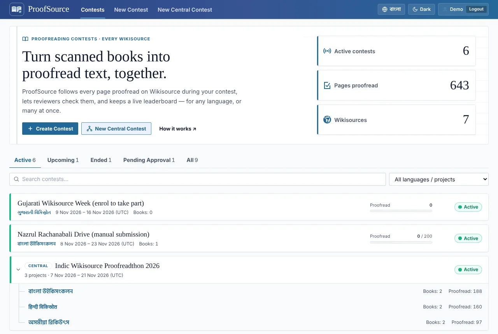
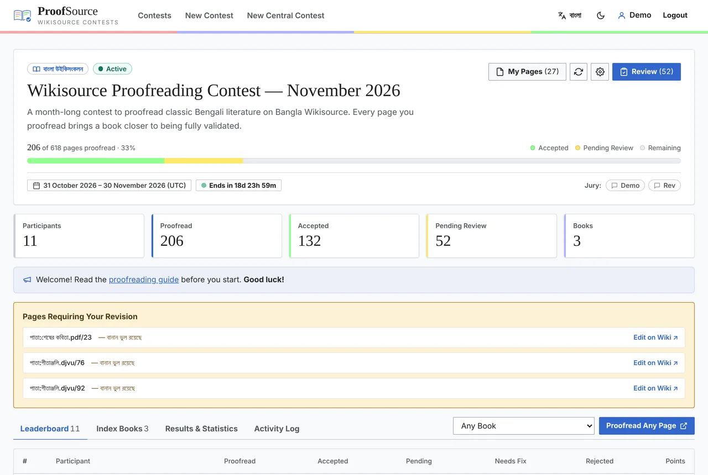
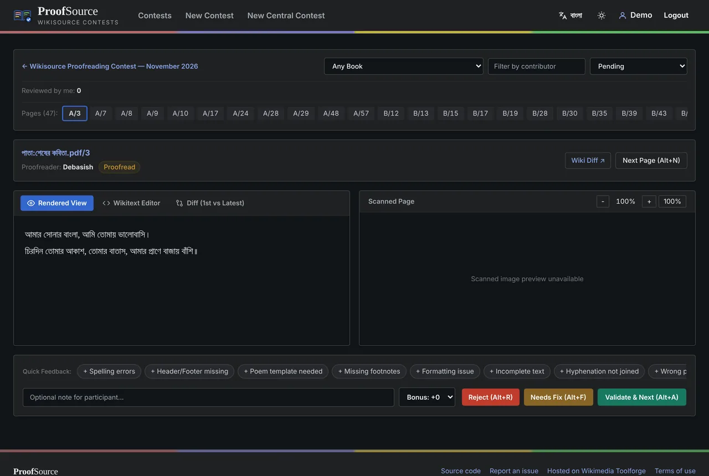
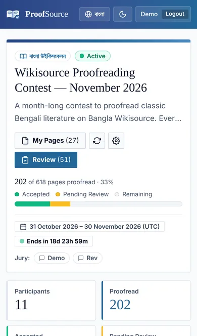

# ProofSource

**Proofreading contests for every Wikisource**

ProofSource finds every page that is proofread on Wikisource during a contest, lets reviewers (juries) accept or reject them, and keeps a live leaderboard. It works on any language edition of Wikisource, and several projects can join one **central contest** with a combined leaderboard.

> 📖 This is the **user guide** ([বাংলা সংস্করণ](README_bn.md)). For the technical design, see [ARCHITECTURE.md](ARCHITECTURE.md); for the security review, [docs/SECURITY_AUDIT.md](docs/SECURITY_AUDIT.md).

  
  

  
  

---

## Table of contents

- [Features](#features)
- [Getting started](#getting-started)
- [For participants](#for-participants)
- [Which pages count](#which-pages-count)
- [For reviewers (juries)](#for-reviewers-juries)
- [For contest admins](#for-contest-admins)
- [Central contests](#central-contests)
- [For Wikisource administrators](#for-wikisource-administrators)
- [FAQ](#faq)

---

## Features

| | |
|---|---|
| 🔍 **Automatic tracking** | Pages proofread inside the contest window are detected from the wiki history. |
| ✅ **Review workflow** | Accept, Needs fix or Reject, with notes, quick feedback chips and optional bonus points. |
| ⚖️ **Fair review distribution** | Open for all reviewers, or pages split equally among them in book order. |
| 📦 **Bulk review** | Select many pages (Shift+click) and accept or reject them at once. |
| 🌐 **Central contests** | Several wikis under one control panel and a combined leaderboard. |
| 📚 **Flexible books** | Per-book points, excluded pages (`1-5, 12`) and per-book time windows. |
| 💾 **Backups** | Full JSON backup and restore, CSV exports, automatic snapshots and reminders. |
| 📝 **Activity log** | Every admin action is recorded and cannot be edited. |
| 🌙 **Comfortable UI** | Wikimedia (Codex) design, English and Bangla, dark mode, mobile friendly, keyboard shortcuts. |
| 🔒 **Private & safe** | No third-party CDNs or trackers; OAuth tokens encrypted at rest; CSRF, CSP and signed backups. |

---

## Getting started

1. Open **https://proofsource.toolforge.org**.
2. Click **MediaWiki Login** (top right) and press **Allow** on Meta-Wiki. The tool never sees your password.
3. Use the **বাংলা / EN** button to switch the language (English is the default) and **Dark / Light** for the theme.

All dates and times are shown in **UTC**.

On the home page, contests are grouped into **Active, Upcoming, Ended and Pending Approval**. Use the search box and the **language / project** filter to find yours. Central contests appear as a folder: expanded while running, folded otherwise. Click the arrow to toggle.

---

## For participants

### Taking part
1. Open the contest from the home page, or use the direct link from the organizers (for example `/contest/bn/wcnov26`).
2. The **Index Books** tab lists the books in the contest, their points per page and any book-specific time window.
3. Click **Proofread Any Page** (you need to be logged in) to open a random unproofread page on Wikisource. You can pick a book first. The page is reserved for you for 20 minutes.
4. Proofread it on Wikisource as usual and save it as **Proofread**. The tool picks it up automatically. Press the sync button (↻) to refresh immediately.

### My Pages
**My Pages** opens your own page (`…/me`) with:
- your rank, proofread, accepted, pending, needs-fix counts and total points
- a breakdown by book
- every page with its status and the reviewer's note

Click any name on the leaderboard to see that participant's pages in the same way.

### When a page "Needs fix"
Pages a reviewer sends back appear at the top of the contest page under **Pages Requiring Your Revision**, with the note. Click **Edit on Wiki**, fix the page, and it goes back to the review queue.

---

## Which pages count

A page counts for you when **both** of these are true:

- ✅ It reaches *Proofread* **for the first time ever** inside the contest window (or the book's own window).
- ✅ **You worked on the text yourself.** You can set *Proofread* in the first edit that creates the page, in the same edit as your corrections, or after several edits of your own.

A page does **not** count when:

- ❌ Someone only changes the status on text written by others.
- ❌ The page was already proofread or validated before the contest.
- ❌ A validated page is moved back to proofread. The credit stays with whoever proofread it first.
- ❌ The page is later reverted to *Not proofread*.
- ❌ It is an excluded page (e.g. table of contents), or by an excluded user or a bot.

**Points:** in contests *with review*, points are added when a page is **accepted**. In contests *without review*, every eligible page counts directly. Validation earns points only if the contest gives validation points.

---

## For reviewers (juries)

If you are a reviewer, the contest page shows a **Review (n)** button.

### The review panel
- **Filters:** book, participant and status (pending / accepted / needs fix / rejected / all).
- **Page chips:** all pages in the filter are listed at the top; click one to open it.
- **Views:** rendered text, wikitext editor, and a diff of the first vs. latest revision. The scanned page is on the right, with zoom.
- **Quick feedback:** one-click notes such as "Spelling errors", or write your own.
- **Bonus:** if the contest allows it, add bonus points when accepting.
- **Decisions:** Accept, Needs fix or Reject. The next page loads immediately.

If the contest uses **"Validate directly on Wikisource"**, accepting also sets the page to *Validated* on Wikisource under your name. With **"Immediately revert"**, rejecting sets it back to *Not proofread*.

### Keyboard shortcuts
They work with any keyboard layout, including Bangla/Avro, and never fire while you are typing a note.

| Shortcut | Action |
|---|---|
| <kbd>Alt</kbd> + <kbd>A</kbd> | Accept (and next) |
| <kbd>Alt</kbd> + <kbd>F</kbd> | Needs fix |
| <kbd>Alt</kbd> + <kbd>R</kbd> | Reject |
| <kbd>Alt</kbd> + <kbd>N</kbd> | Next page |

### Rules
- **You can never review your own pages.** They do not appear in your queue.
- In **Equal share** mode you only see the pages assigned to you; the panel shows *Reviewed by me* and *Assigned to me (remaining)*.
- An open page is locked to you for 10 minutes so two reviewers don't work on it at once.

### Bulk review
If the admin has enabled it, the panel shows **Select pages**:
1. Filter as needed (for example by book or by participant).
2. Click **Select pages**, then click page chips. <kbd>Shift</kbd>+click selects a range, and **Select shown** selects every visible chip.
3. Click **Accept selected** or **Reject selected**, then confirm.
4. A summary shows done, skipped (own) and failed pages. A failure never undoes the pages that succeeded.

Contest admins also get **Select all in filter**, for example to accept every page of one participant.

---

## For contest admins

### Creating a contest
Click **Create Contest** on the home page and fill in:

| Field | Notes |
|---|---|
| Name, project, description | |
| Link slug | e.g. `wcnov26` → `/contest/bn/wcnov26`. Leave empty for a random one. |
| Start / end (UTC) | |
| Points | Default points per page; validation points (0 = validation is not counted or shown); max bonus. |
| Admins, reviewers | Comma-separated Wikimedia usernames. |
| Excluded users | Bots are excluded automatically. |
| Review | *With review*, or *Without review* (like a Proofread Week). |
| Review distribution | *Open for all* or *Equal share*. |
| Review mode | Accept/reject in the tool only, or validate directly on Wikisource. |
| Rejected pages | Revert in one batch after the contest, or immediately. |
| Announcements | English and Bangla. |
| Index pages | One per line, e.g. `Index:Book.djvu` or `নির্ঘণ্ট:বই.pdf`. |

If you are an administrator of that Wikisource, the contest is active immediately. Otherwise it waits until a local administrator or the tool admin approves it.

### Configuration (⚙)
- Every setting can be changed later, and each change is recorded in the **Activity Log**.
- **Books:** set custom points, excluded pages and a book-specific time window, then press **Update**.
  - Excluded pages: `1-5, 12` excludes pages 1 to 5 and page 12. Invalid input is rejected with a message.
  - An empty book window means the contest window applies. A book window may extend outside the contest dates.
- **Removing a book:** *Retain pages & points* stops tracking but keeps earned points; *Delete book* removes its pages and points.
- **Changing the slug** keeps old links working; they redirect to the new one.
- **Notice board:** shown on the dashboard when filled in, completely hidden when empty. Supports `[[Page|text]]`, `[https://link text]` and `'''bold'''`.

### Equal share reviewing
With **Equal share**, pending pages are divided equally among reviewers, keeping consecutive pages of the same book together.
- Turned on **before** the contest, new pages are shared out as they arrive.
- Turned on **midway**, pages already reviewed count toward each reviewer's share. Example: 1000 pages and 5 reviewers means 200 each, so a reviewer who already did 20 gets 180 more.
- Changing the reviewer list re-balances the pages.
- As an admin, switch between **Mine / All** in the review panel.

### Results & statistics
- **Generate WikiTable result code:** the leaderboard and reviewer statistics as wiki tables, ready to paste on-wiki.
- **Download leaderboard CSV**
- A daily proofreading chart.
- **Revert rejected pages:** with the batch rule, set rejected pages back to *Not proofread* after the contest (up to 50 per click; press again if more remain).

### Activity log
Visible to admins only. It records who changed what and when, with old and new values: configuration, books, points, review decisions, bulk reviews, backups and more. Nobody can edit or delete it.

### Backup & restore
At the bottom of the configuration page:
- **Download full backup (JSON):** the complete contest, restorable. A copy is also kept on the server.
- **Download all pages (CSV):** for spreadsheets.
- **Restore:** choose a JSON backup. It is verified first, then press **Restore this backup**. A safety copy of the current data is saved automatically. Only an intact backup of this same contest is accepted. Every backup is signed by the server; backups made elsewhere (or old, unsigned ones) can only be restored by the tool admin. A restore never changes the contest's approval, creator, wiki or link.
- **Reminders:** you are reminded on the dashboard if no backup was taken for 7 days.

### Deleting a contest
Admins cannot delete a contest themselves. In the **Danger zone** of the configuration page, click **Request deletion** and give a reason. The tool admin reviews the request and deletes the contest, saving a full backup on the server first. You can **cancel the request** at any time before that.

---

## Central contests

Use a central contest when several Wikisource projects run one event together, for example an "Indic Wikisource Contest". The central contest is a **control panel**: it sets the shared rules, and each project configures its own part.

### For organizers
1. Click **New Central Contest** on the home page.
2. Enter the name, slug, description, event page link, start/end (UTC), points per page, validation points and the central admins.
3. Under **Rules for all projects**, choose **Allowed / Not allowed / Project decides** for:
   - custom points per book
   - bonus points
   - jury review
4. Under **Included projects**, add each project and its project admins.
5. Save. One contest is created for each project, and they appear as a tree under the central contest on the home page.

Created by the tool admin or by an administrator of any included Wikisource, the central contest is active immediately. Otherwise it waits for their approval.

### For project admins
- Open your project from the central contest page or from the home-page tree.
- In **Configuration**, add Index books, reviewers, announcements, excluded pages and so on, just like a normal contest.
- Dates, points per page, validation points and the centrally fixed rules are locked (greyed out). Rules marked *Project decides* are yours to choose.

### The central contest page
- **Global leaderboard:** points from all projects combined. The same username on different wikis counts as one person, with a per-project breakdown.
- **Included projects:** each project's admins, books, participants and points.
- **Results & statistics:** a combined WikiTable result generator (with a copy button), a daily chart and a project comparison.

---

## For Wikisource administrators

If you are an administrator (sysop) of a Wikisource:
- Contests you create on your wiki are active immediately.
- Contests created by others on your wiki show **Approve & Activate** and **Reject** at the top.
- You can also approve central contests that include your wiki.

The **Pending Approval** tab on the home page lists everything waiting.

---

## FAQ

<b>My proofread page is not on the leaderboard. Why?</b>

Press sync (↻) first. Then check:
- Is the page in one of the contest books?
- Was it proofread for the first time inside the contest or book window?
- Did you work on the text yourself?
- Is it in the excluded pages?

See [Which pages count](#which-pages-count).

<b>Why don't I see my own pages in the review panel?</b>

Reviewers can never review their own pages, so they are hidden from your queue.

<b>Why do I see only some of the pages?</b>

The contest probably uses *Equal share*, so you see only the pages assigned to you.

<b>Login does not work.</b>

Reload the page (<kbd>Ctrl</kbd>+<kbd>F5</kbd>) and click **MediaWiki Login** again. If it still fails, contact the tool maintainer.

<b>Does it work on mobile?</b>

Yes. The whole tool works on phones, tablets and desktops.

---

Made for the Wikisource community · Hosted on Wikimedia Toolforge

